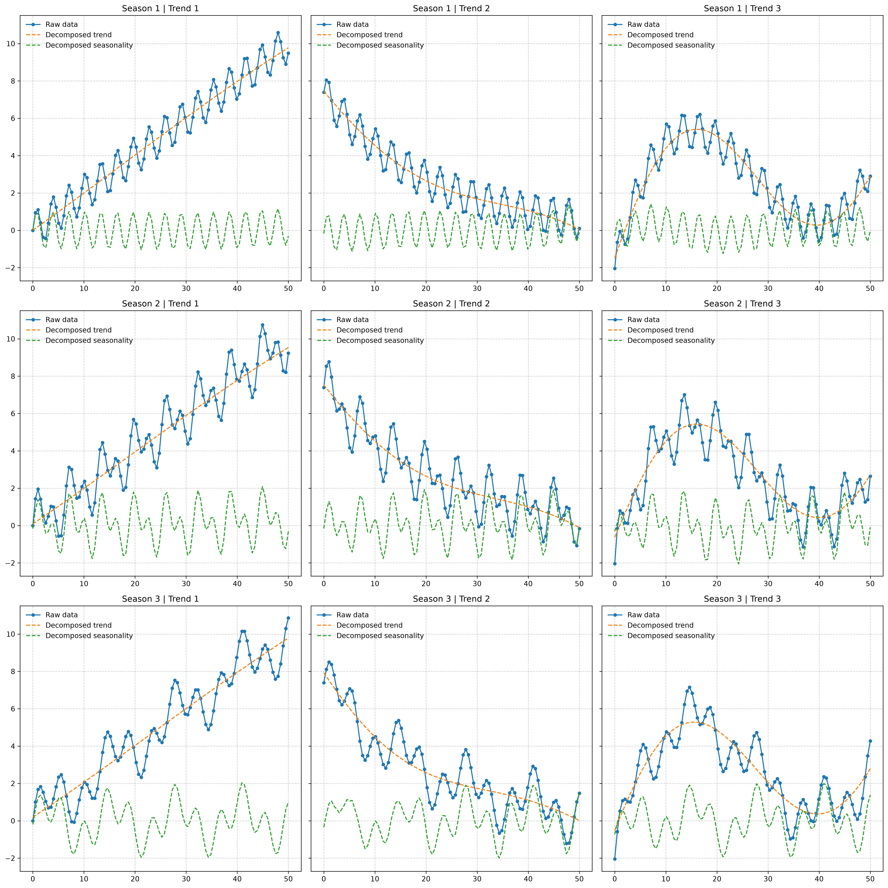

# INR-TSD: Implicit Neural Representations for Time Series Decomposition with Periodic Activation Functions

INR-TSD decomposes time series into trend and seasonality using two single-hidden-layer neural networks with sinusoidal activations. The trend is fitted first, followed by the seasonal component of the detrended signal.

This repository contains the core implementation and nine synthetic benchmark series. Biomedical analyses, baseline comparisons, and forecasting experiments are outside the scope of this package.



## Installation

Use **Python 3.11** and run the following commands from the repository root. Choose one environment method and one installation option.

### 1. Create an environment

**Option A: venv**

```bash
python3.11 -m venv .venv
source .venv/bin/activate
python -m pip install --upgrade pip
```

**Option B: conda**

```bash
conda create -n inr-tsd python=3.11 -y
conda activate inr-tsd
python -m pip install --upgrade pip
```

### 2. Install dependencies

**CPU — Linux / Windows (x86-64)**

```bash
python -m pip install -r requirements/cpu.txt
```

**CPU — macOS**

```bash
python -m pip install -r requirements/macos.txt
```

**NVIDIA GPU — Linux / Windows WSL2 (x86-64)**

```bash
python -m pip install -r requirements/gpu.txt
```

The GPU option installs TensorFlow with CUDA dependencies and requires a compatible NVIDIA driver. Use a fresh environment for your selected installation option.

## Usage

Run decomposition on the supplied synthetic datasets:

```bash
python main.py
```

The script fits nine series and saves the estimated components to `results/season{s}_trend{t}_decomposed.csv`, together with `results/decomposed_results.png` and `.eps`. The `model/` and `results/` directories are created automatically.

The input datasets are already included. To regenerate them:

```bash
python data_generation.py
```

Keep `dataset/trend3.csv`, which supplies the third trend. These commands overwrite the corresponding generated data, results, and checkpoints.

Each output CSV contains `time`, `actual_value`, `predicted_trend`, and `predicted_seasonality`.

## Configuration

Edit `config.py` before running the program.

### Seasonal model width

The trend model uses 40 hidden nodes. The seasonal model uses $H_S=\lceil N/2.5\rceil$, where $N$ is the number of observations in the input series.

```python
TREND_HIDDEN_UNITS = 40
SEASONAL_WIDTH_DIVISOR = 2.5
```

For example, 100 observations give 40 seasonal nodes, and 250 observations give 100. The current implementation recalculates the width for each input; controlled experiments requiring a fixed width across degraded inputs need a separate override.

### Trend initialization frequency range

Trend time is normalized to $[0,1]$. The initial frequency weights span $[0,\Omega_T]$, where $\Omega_T=2\pi C_T^0$ and $C_T^0$ is the maximum initial number of cycles over the observation window.

The default configuration is:

```python
TREND_INIT_MAX_CYCLES = 1 / (2 * math.pi)
TREND_INIT_MAX_FREQUENCY = 2 * math.pi * TREND_INIT_MAX_CYCLES
```

This gives the original frequency range $[0,1]$, corresponding to approximately 0.159 initial cycles. To initialize up to **one cycle** over the observation window, change:

```python
TREND_INIT_MAX_CYCLES = 1.0
```

Keep the derived `TREND_INIT_MAX_FREQUENCY` expression. The resulting frequency range is $[0,2\pi]$.

Larger values allow faster variation in the initial trend representation. Frequencies remain trainable, so this setting is an initialization scale rather than a hard cutoff. The seasonal initialization range is controlled separately by `SEASONAL_INIT_MAX_FREQUENCY = 1.0`.

### Training settings

| Parameter | Default |
| --- | --- |
| `INITIAL_LR` | `1e-7` |
| `TREND_TARGET_LR` | `0.1` |
| `SEASONALITY_TARGET_LR` | `0.01` |
| `WARMUP_STEPS` / `DECAY_STEPS` | `100` / `200` |
| `BATCH_SIZE` | `500` |
| `TREND_EPOCHS` | `500` |
| `SEASONALITY_EPOCHS` | `(500, 200, 200)` |
| `GLOBAL_TF_SEED` / `DATA_SEED` | `2` / `41` |

Both models use Adam and mean absolute error. Schedule steps refer to optimizer updates; the implemented cosine is not clamped after step 200.

## Custom data

For a CSV containing `time` and `value` columns:

```bash
python examples/decompose_csv.py --input path/to/series.csv --output results/custom_decomposed.csv
```

Use at least three finite observations with strictly increasing times and nonconstant values. The example shifts time to start at zero for fitting and preserves the original timestamps in the output.

## Repository structure

```text
config.py                  Model and training settings
main.py                    Synthetic benchmark decomposition
data_generation.py         Synthetic dataset generation
requirements/              Shared, CPU, GPU and macOS dependencies
source/                    Models, training, normalization and generators
dataset/                   Synthetic inputs and reference trend
results/                   Example decomposition outputs
examples/decompose_csv.py   Custom-CSV example
LICENSE                    MIT license
```

Training checkpoints are written to `model/` and reused for each series.

## Citation and license

Please cite the associated INR-TSD manuscript and the software version used. Final manuscript citation and repository/archive identifiers will be added when available.

Released under the [MIT License](LICENSE).
